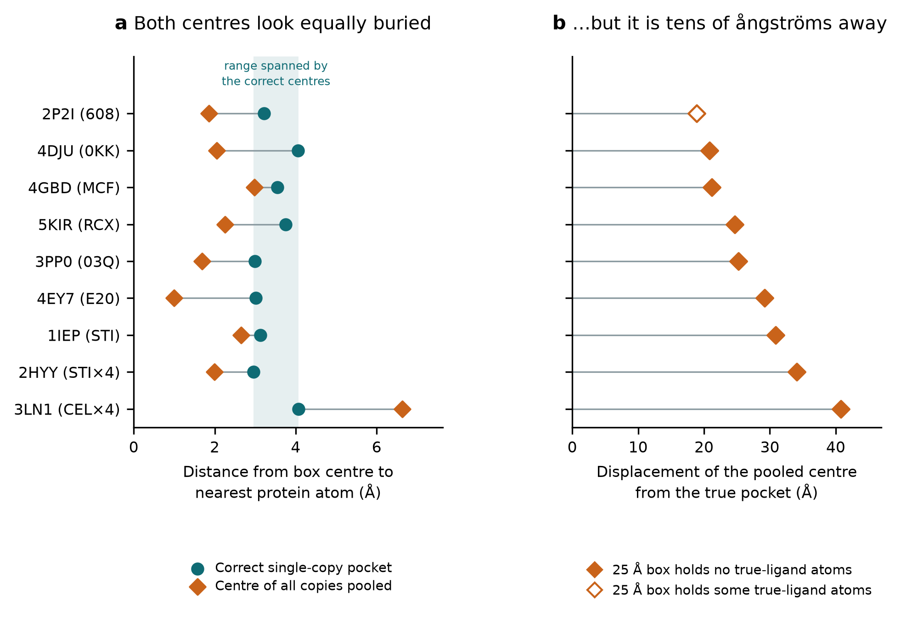

# Grid Box Finder

**Define an AutoDock Vina search box — and check it before you dock.**

Type a PDB ID, pick the ligand, get the box. Runs entirely in your browser: no install, no
account, no upload. Structures never leave your machine.

**→ [Live tool](https://YOURNAME.github.io/grid-box-finder/)** · single HTML file · MIT licence


---

## Why this exists

Most docking tutorials tell you to centre the box on the co-crystallised ligand and add a margin.
That advice is incomplete, and the gap is not obvious.

I checked 25 protein–ligand complexes. **Nine of them (36%) contain more than one copy of the
ligand.** Selecting the ligand by its three-letter residue code — the default behaviour in most
workflows — selects every copy, and the centroid of that selection lands between the protein
chains.

The consequences:

| | |
|---|---|
| Median displacement of the box centre | **25 Å** (range 18.9–40.8) |
| A conventional 25 Å cube at that centre | **contains zero atoms of the true ligand in 8 of 9 cases** |
| Auto-sized to the pooled selection instead | box edge becomes **56–92 Å** — a search volume one to two orders of magnitude too large |
| Does Vina complain? | **No.** It completes and reports affinities in kcal mol⁻¹ |

And the check people are taught — *"look at the 3D view, is the box on the protein?"* — does not
catch it. Correct box centres sit 3.0–4.1 Å from the nearest protein atom. The pooled centres sit
1.0–6.6 Å, and in eight of nine cases they are **closer** to protein than the correct range's floor,
because they wedge against the chain–chain interface. A wrong box looks exactly as buried as a
right one.



One of the nine resists the pattern: in 2P2I the pooled box still retains 11 of the ligand's 30
atoms. The error is not quite universal, which is exactly why it has to be checked per structure
rather than remembered as a rule.

**Scope, stated honestly.** If you dock against a receptor someone already prepared — one chain,
one ligand, waters stripped — this particular error cannot reach you. It reached whoever prepared
the file: 14 of the 25 raw deposits contain more than one protein chain, so preparation involves
a choice, and nothing downstream records whether it was made correctly. Two things still apply to
a prepared file. Keeping protein chain A while retaining the *other* copy's ligand puts the centre
15.0–32.9 Å from the kept chain — the centre-in-pocket check flags all nine such cases in this
set. And box size: none of the 25 ligands needs a cube larger than 25 Å (a 2 Å margin fits every
one inside 11–22 Å), so the "25 Å is standard" habit searches a median 3.2× — up to 11.7× — more
volume than necessary.

So this tool makes the box visible and checks it. That is the whole idea.

## What it does

- **Loads PDB and mmCIF**, or fetches any structure by PDB ID
- **Classifies every HETATM group** into nine classes — likely drug/ligand, substrate/nucleotide
  sugar, cofactor, lipid/sterol, sugar, additive/detergent, ion/buffer, water, modified residue —
  and pre-selects by class tier, so UDP-GlcNAc does not outrank a phosphonate inhibitor and
  cholesterol does not outrank a receptor's agonist
- **Computes centre and size** with a margin slider and an optional cube constraint
- **Renders the box in 3D** around the protein, live, via [3Dmol.js](https://3dmol.csb.pitt.edu/)
- **Checks the box**: centre-to-nearest-protein-atom distance, oversized-box warning, and the
  multiple-copy warning — which tells you where the pooled centre *would* have landed and how far
  that is from your pocket
- **Lists pocket residues** within a chosen cutoff, for comparing your site against a paper
- **Residue mode** for apo structures: type `A:120 A:355 A:530` and it reports which residues it
  could not find, instead of silently building a box from nothing
- **Exports** six labelled numbers for PyRx, a ready-to-save Vina `config.txt`, and a JSON
  provenance record (structure, ligand, margin, box, cutoff, checks, tool version, timestamp) for
  your methods section

## Method notes

The centre is the **centroid of the selected site's heavy atoms**. Each edge is
`ceil(2 × max|atom − centre| + 2 × margin)`, computed per axis — sized from the greatest
centre-to-atom distance rather than from the bounding-box span, so the requested margin is
guaranteed on **every** face even though the centroid of an asymmetric ligand is offset from its
bounding-box midpoint (median offset 0.9 Å, max 1.9 Å across the 25 complexes). The bounding-box
midpoint is displayed alongside, for comparison with AutoDockTools, which reports that convention.

Hydrogens and alternate conformations other than A are ignored. Multi-model files use model 1.
`auth_*` identifiers are used when reading mmCIF, so chain letters and residue numbers match PDB
format and the numbering used in the literature.

**Known limits.** Molecule classification uses a fixed residue-code dictionary, so an unusual
ligand with no entry falls through to *likely drug / ligand* by default. No class is excluded from
the ranking — whatever the dictionary decides, every molecule stays selectable, and the interface
flags the class whenever a non-ligand group is pre-selected. That matters because the molecule of
interest is sometimes itself a cofactor analogue (biotin in streptavidin, methotrexate in
dihydrofolate reductase) or a lipid. Within a class the ranking is by atom count, so where a
structure holds both a large genuine cofactor and a smaller drug — NADPH and methotrexate in human
dihydrofolate reductase, for instance — the cofactor is pre-selected and you must switch. The
flag exists precisely because no residue-code dictionary can decide which molecule a given study
is about. This tool defines a search box — it does not predict binding sites. With neither a
co-crystallised ligand nor literature residues, use a pocket-detection method instead.

The mmCIF reader was validated atom-for-atom against the PDB-format parse of 5KIR, 1IEP and 3NY8.
The sizing rule was checked to hold the requested margin on every face at both the minimum (2 Å)
and default (7 Å) settings for every auto-selected ligand in the benchmark set. Class assignments
were checked against the RCSB chemical component dictionary.

## Install

None. Download `grid-box-finder.html` and open it, or host it on GitHub Pages. The 3D panel loads
one library from a CDN; if that is blocked, the numbers and every check still work. For fully
offline use, download 3Dmol.js next to the HTML file and point the `<script>` tag at it.

## Repository layout

```
grid-box-finder.html              the tool
LICENSE                           MIT
CITATION.cff                      how to cite
docs/screenshot.png               interface screenshot
docs/fig_box_failure_modes.png    the figure above
analysis/gridbox_pilot_benchmark.csv   the 25-complex dataset
analysis/box_failure_modes.py          script reproducing the figure
teaching/                         classroom handout, instructor notes, answer key
```

## Citing

See `CITATION.cff`, or cite the archived release DOI.

## Credits

3D rendering by [3Dmol.js](https://3dmol.csb.pitt.edu/) (Rego & Koes, *Bioinformatics* 2015,
BSD-3-Clause). Structure data from the [RCSB PDB](https://www.rcsb.org/). Example structure
[PDB 5KIR](https://doi.org/10.2210/pdb5KIR/pdb), rofecoxib bound to human COX-2
(Orlando & Malkowski, *Acta Cryst. F* 2016). Box-size guidance informed by eBoxSize
(Feinstein & Brylinski, *J. Cheminform.* 2015).

Released under the MIT licence.
